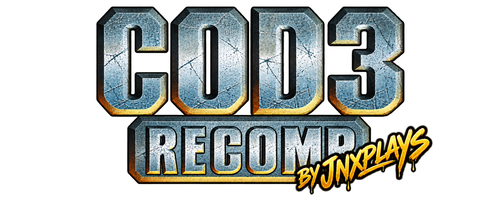

<div align="center">
  
</div>

<div align="center">

       

[](LICENSE)
[](https://learn.microsoft.com/en-us/windows/)
[](#)

</div>

# COD3 Recomp

**Call of Duty 3** (Xbox 360, 2007) running as a **native Windows PC binary**.

The Xbox 360 executable is translated ahead-of-time from PowerPC to x86-64 with
[XenonRecomp](https://github.com/hedge-dev/XenonRecomp), and this project supplies
the runtime the translated code links against: guest memory, the PowerPC dispatch
table, the Xbox 360 kernel API surface, the Xenos GPU command processor and a
Direct3D 11 renderer that draws the title's own shaders.

There is no emulation layer and no dynamic translation at run time — once
compiled, the game code is ordinary x86-64 that the OS runs natively.

**Source dump** (read-only): your own copy of `default.xex`.

> **Status: this is a working port, and the remaster work is starting.** The
> inherited runtime is solid enough that levels load, render and play. What is
> *not* done is everything this project intends to add on top. See
> [Roadmap](#roadmap) for where the line is, and please read
> [Known gaps](#known-gaps) before reporting a bug — several are long-standing
> and documented rather than hidden.

---

## Provenance — please read

This repository is a **continuation** of the work in
[`FrankHUN88453/CoD3Recomp`](https://github.com/FrankHUN88453/CoD3Recomp), which
reached a working, rendering port of Call of Duty 3 through static recompilation.
That project is the foundation here, and its runtime is what this one builds on.

The runtime — the kernel, the GPU command processor, the D3D11 renderer, the
Xenos shader translator, the audio and input paths — is his work, under the
**BSD 3-Clause** licence. That notice is retained in [LICENSE](LICENSE); it is a
condition of the licence and this repository keeps it.

What this project adds is the direction, the roadmap and the work on top. We are
not presenting his port as ours.

See [docs/PROVENANCE.md](docs/PROVENANCE.md) for the full picture, including
what this repository inherited and what it changed.

---

## What works

What the inherited port does. **Read this table as inherited and reported, not
independently re-verified by us** — we have measured less of it than it claims,
and [Known gaps](#known-gaps) and [STATUS.md](STATUS.md) are the honest sources.

| | |
|---|---|
| **Boot** | Loads `default.xex`, maps 15 sections, enters guest code |
| **Kernel** | 179 Xbox 360 imports present in the table; a handful are stubs |
| **Recompilation** | ~19.4k functions, main game plus 15 level DLLs |
| **GPU** | Xenos PM4 command processor decodes the register writes |
| **Rendering** | Direct3D 11, the title's own shaders via HLSL |
| **Assets** | Streams level archives from the game directory |
| **Audio** | XMA decoded through FFmpeg |
| **Input** | Keyboard, mouse and pad |
| **Settings** | Resolution, filtering, anisotropy, AA, FOV, FPS cap |

### What we have verified ourselves

Small list, but it is measured rather than inherited. Saint-Lô (`saint_lo`)
was run end-to-end on this build: it loads, streams its archives, and renders —
**299 fps, 74 files, 195 MB read**, at 1280x720.

That is **one of fifteen levels.** The other fourteen are compiled and linked;
we have not run them. If you are the first to try one, please open an issue
either way.

Measured and confirmed:

- `rldicr`'s mask. We changed it to match Xenia's own instruction tests, which
  broke the title badly enough that it would not boot. **Reverted.** Where MB is
  31 or more, the tests and this title's code genuinely disagree, and the code
  that runs is the one that counts. The finding is written up in the recompiler
  and in `docs/GAPS.md`, because "matches the test suite" is not the same as
  "correct" and here they came apart.
- Input latency. The message pump runs 540 rounds a second, one every 1.85 ms,
  so end-to-end input latency is that plus at most one frame. Aim mapping is
  confirmed `MAP_LINEAR`, so there is no response curve to compensate for.
  Details and the list of leads already exhausted: `docs/MOUSE.md`.

## Known gaps

Stated plainly, because a port that hides its holes is harder to help with.

From the inherited work:

- Depth, blend and stencil coverage is narrower than the hardware's
- Several texture and vertex formats are counted and named at run time, not
  implemented
- Texture sampling is nearest; edges are harder than they should be
- `RtlRaiseException` / `RtlUnwind` report and stop — anything that throws is
  unrecoverable. **This is why the kernel row above does not say "all
  implemented."**
- The recompiled output has not been verified instruction-by-instruction against
  the original

Ours:

- **Mouse look is unresolved.** An attempt to fix it was reverted in full; see
  `docs/MOUSE.md` for what was measured and what has already been ruled out. The
  open lead is upstream in the kernel: `XamUserReadProfileSettings` reports all
  eight settings as unset, so the title falls back to its own default
  sensitivity and nothing persists.
- **Frame rate is not understood.** The same build and level have been observed
  at 22 fps, 144 fps and 299 fps. We do not yet know what the difference is, and
  we are not going to guess in public.
- 40 of Xenia's instruction tests fail, all sharing one root cause in the
  four-argument `make_full_test_constant` macro and the `clrldi r3,r3,32` inside
  it. Not yet solved.

[STATUS.md](STATUS.md) carries the detail and the measurements behind the
inherited work.

---

## Building

Requires **CMake 3.20+**, **Ninja**, **Clang** (not optional — the generated code
depends on Clang intrinsics and the `alias` attribute used for function hooking),
and Visual Studio or the Visual Studio Build Tools for the Windows SDK headers
and `rc.exe`. A PowerShell 5+ shell.

Put your `default.xex` in `CoD3RecompLib/private/` first. Nothing of the game is
committed, so there is nothing to clone and run until you supply it.

### 1. Patch the XenonRecomp submodule

The recompiler carries fixes this project depends on. They live as a patch so
they apply to a pristine checkout:

```powershell
git submodule update --init tools/XenonRecomp
git -C tools/XenonRecomp apply ..\patches\XenonRecomp.patch
```

Skip this and the recompiler mistranslates the title.

### 2. Fetch the FFmpeg headers

They are GPL and deliberately not committed. This downloads them:

```powershell
.\scripts\get_ffmpeg_headers.ps1          # pinned to FFmpeg 8.1 (avcodec-62)
```

Without this the build has no XMA decoder and there is no audio.

### 3. Build the tools and recompile the main game

```powershell
.\scripts\recompile.ps1 -BuildTools -BuildLib -BuildHost
```

Hours. ~19.4k functions. It compiles the main game into `CoD3RecompLib/ppc/`
and builds the host.

### 4. Recompile every level

```powershell
.\scripts\recompile_level.ps1 -All        # 15 more DLLs, also hours
```

**These are separate libraries and this step is not optional.** `-BuildLib` does
*not* build them — the level targets are not in the default build. Skipping this
produces a host that starts, shows a black window and hangs before it draws
anything, which looks like a driver problem and is not one.

### 5. Reconfigure and build

The level libraries are discovered by CMake at **configure** time, so step 4
created 15 new targets that the existing build tree knows nothing about. Run
CMake directly — do not go back through `recompile.ps1`, whose recompile stage
is not optional and would repeat the hours from steps 3 and 4 for no reason:

```powershell
$bt = 'C:\Program Files (x86)\Microsoft Visual Studio\2022\BuildTools'
& cmd /c "`"$bt\VC\Auxiliary\Build\vcvars64.bat`" >nul 2>&1 && set PATH=$bt\Common7\IDE\CommonExtensions\Microsoft\CMake\CMake\bin;$bt\Common7\IDE\CommonExtensions\Microsoft\CMake\Ninja;C:\PROGRA~1\LLVM\bin;%PATH% && cmake -S . -B build -G Ninja -DCMAKE_BUILD_TYPE=Release -DCMAKE_C_COMPILER=clang-cl -DCMAKE_CXX_COMPILER=clang-cl && cmake --build build --parallel 4"
```

Substitute your own Visual Studio path — `recompile.ps1` globs for it rather than
naming one, which is why it keeps working across VS versions.

`recompile.ps1` applies the coroutine patch after recompiling; without it the
first level's scripts spin forever.

**On parallelism:** the default in `recompile.ps1` is your core count, and that
will run the machine out of memory. Clang-cl holds several GB per translation
unit and the generated code is 549 MB of it. **`--parallel 4` is what works** on
a 32 GB machine. Lower it if you are short on memory; going above 4 buys little
and risks a failed build with `LLVM ERROR: out of memory`. We hit exactly that at
16 jobs on this machine.

You should end up with `build/CoD3Host/CoD3.exe`.

### Checking your work

```powershell
.\scripts\verify.ps1        # mechanical build and behaviour checks
.\scripts\verify.ps1 -All   # plus the instruction tests
```

`-All` currently reports **40 failures**, all from one root cause in Xenia's
test macros (see [Known gaps](#known-gaps)). That is the known baseline, not a
regression you introduced.

## Running

`CoD3.exe` looks for a `game` folder beside itself and offers to install from a
disc image (XGD1/XGD2/XGD3 all recognised), from a folder you already extracted,
or in place from a folder elsewhere.

```
CoD3.exe --iso  "D:\Call of Duty 3.iso"
CoD3.exe --game "D:\Call of Duty 3 (USA, Europe)"
CoD3.exe --help
```

| Key | |
|---|---|
| `F11` | settings menu |
| `F12` | screenshot, plus the next two frames' draws to `CoD3.log` |
| `` ` `` | the title's own console (`spmap forest`, `god`, `noclip`) |
| `Escape` | pause |

---

## Roadmap

**Call of Duty 3 Remastered.** The port is the foundation; the remaster is the
project. The 360 original is capped at 720p, 4:3, 30 fps, with no settings menu
worth the name and no widescreen. None of that is a hardware limit — it is what
shipped on a seven-year-old console. A recompiled build running on a modern GPU
has no reason to inherit any of it.

**Phase 1 — a stable base.** All fifteen levels run, the campaign plays start to
finish, saves work. Then close the inherited gaps: depth, blend and stencil
coverage, the missing texture and vertex formats, filtering that is not nearest-
neighbour, and `RtlRaiseException` so a thrown exception is not the end of the
process. Make what runs be what shipped, then improve on it.

**Phase 2 — modern settings and presentation.** An Escape-key settings menu
covering what the 360 never exposed: resolution and windowed modes, ultrawide and
arbitrary aspect ratios, uncapped frame rate, shadow and lighting options,
anisotropic filtering done properly, and per-user profiles.

**Phase 3 — remaster features.** The ones the design invites: custom servers,
larger multiplayer matches, modern input handling, and beyond.

Work is ordered by what unblocks the next thing, and every claim on this page
gets measured before it is believed. Where we do not know — the mouse, the frame
rate swing — we say so rather than guessing. Contributions welcome; see
[Known gaps](#known-gaps) for the shortest route to something useful.

## Layout

| Path | |
|---|---|
| `CoD3Host/` | the executable: kernel, renderer, GPU, audio, input |
| `CoD3RecompLib/config/` | recompiler configuration, every address documented |
| `scripts/` | the pipeline, analysis tools and frame comparison |
| `tools/` | XenonRecomp (patched submodule), XEX scanner, PowerPC assembler |
| `docs/` | renderer design, kernel import list, provenance, findings |

## Legal

This repository contains **no Activision or Treyarch assets**, no game code, no
game data, no game audio and no screenshots of the game. It is build
configuration, tooling and a host runtime that target a separately supplied,
legally owned copy of the game. (Game screenshots that were committed here
earlier have been removed for exactly that reason.)

You provide your own disc or dump. Please do not ask where to obtain one.

The port derives from [`FrankHUN88453/CoD3Recomp`](https://github.com/FrankHUN88453/CoD3Recomp),
used with his permission. Its BSD 3-Clause notice is retained in
[LICENSE](LICENSE). We are grateful for it — this project would not exist
without it. Please treat that attribution as a condition of use, not a
formality; the provenance is spelled out in
[docs/PROVENANCE.md](docs/PROVENANCE.md).

## Licence

Our own work is MIT. The inherited runtime is BSD 3-Clause and retains its
notice. See [LICENSE](LICENSE).
